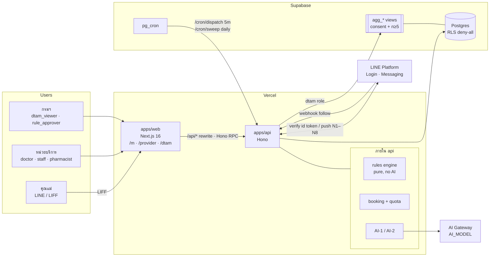

# Architecture — เรือนไฟ

> สรุปเป็นหน้าเดียว รายละเอียดอยู่ใน `specs/` ส่วนเหตุผลของแต่ละการตัดสินใจอยู่ใน `adr/`

## 1. ภาพรวม



## 2. ขอบเขตความรับผิดชอบ

| ส่วน | ทำ | ไม่ทำ |
|---|---|---|
| `apps/web` | render UI, LIFF init, เรียก API ผ่าน `hc` | ไม่มี business rule, ไม่มี DB key, ไม่ตัดสินผลคัดกรอง |
| `apps/api` | auth, authorization, rules engine, booking/quota, stock, outbox, LINE, AI | ไม่ render UI |
| rules engine | `questionsFor(profile)`, `evaluate(...)`, `drugWarnings(...)`, `windowFor(...)` เป็น pure function | ห้ามเรียก I/O / LLM |
| Supabase | เก็บข้อมูล, aggregate views, pg_cron | ไม่มี policy ให้ client (RLS deny-all) |
| LINE | ช่องทางเข้า + แจ้งเตือน | ห้ามมีข้อมูลสุขภาพในแชท |
| AI Gateway | LLM สำหรับ AI-1/AI-2 | ห้ามเห็นข้อมูลรายคน |

## 3. โครงสร้าง repo (เป้าหมาย)

```
apps/
  web/src/
    app/
      m/          consent · profile · screening/[step] · results · refer · calendar
                  booking/[step] · appointments · checkin/[id] · meds · review/[id] · sharing · emergency
      provider/   login · schedule · queue · cases/[id] · treatment/[id] · prescribe/[id] · inventory · reviews
      dtam/       overview · outcomes · safety · access · drugs · satisfaction · ai · rules
    lib/api.ts    hc<AppType>
  api/src/
    index.ts      mount routes, export AppType
    routes/       auth · mother · booking · provider · inventory · dtam · line · cron
    rules/        ruleset.v1.json · engine.ts · engine.test.ts
    booking.ts    availability ∩ window ∩ quota
    stock.ts      FEFO decrement, low-stock / expiry flags
    outbox.ts     enqueue(template, mother, at, dedupe)
    line.ts       verifyIdToken · push
    ai/           ai1.ts · ai2.ts · scrub.ts
    auth.ts       session JWT, requireRole()
    db.ts
supabase/
  migrations/     0001_init.sql · 0002_aggregates.sql · 0003_cron.sql
  seed.sql
docs/
```

## 4. Data flow หลัก

### 4.1 คัดกรอง → จอง (M2 → M3 → M4 → M6)
1. `PUT /me/profile` → API บันทึก แล้ว **คำนวณผลเดิมใหม่** ถ้าวันคลอด/วิธีคลอดเปลี่ยน
2. `GET /me/screening/questions` → engine คืนรายการคำถามตาม profile (16–19 ข้อ) พร้อม metadata `onYes`, `onUnsure`
3. web เดิน flow จาก metadata (A1 yes → A1a, เจอข้อส่งต่อ → M4-R ทันที) แต่ **server เป็นตัวตัดสินจริง** ตอน submit
4. `POST /me/screenings` → engine.evaluate → บันทึก `screenings(result, ruleset_version)` → ถ้าเข้าเกณฑ์ส่งต่อ สร้าง `referral_lock`
5. `GET /units/:id/availability` = slot ว่างของหน่วย ∩ กรอบเวลาของหัตถการ (`unit_start_days` ≥ ค่าคู่มือ) ∩ ยังไม่เลยเส้นตาย ∩ quota (≤5 ครั้ง/3 เดือน, ≤1 ครั้ง/วัน)
6. `POST /me/appointments` → status `pending`, สร้าง share ถ้าติ๊ก, enqueue N3 (วันก่อนนัด)

### 4.2 เช็กอินก่อนนัด (M8)
คำถามอันตราย 5 ข้อ (+ A1a) + ความปวด 0–10 → engine
- ตอบ yes ข้อไหน → M4-R + lock
- ตอบ unsure / คำตอบเปลี่ยน → นัดเป็น `awaiting_eval` + `staff_alert` + แสดงแถบบนสุดใน P3

### 4.3 วันรับบริการ (P3 → P4 → P5 → P6)
ยืนยันนัด → เปิดใบสรุป (log access) → บันทึกการรักษา (ต้องติ๊กตรวจสิทธิ์) → สั่งยา (engine.drugWarnings → แพทย์กด "เปลี่ยนยา" หรือ "รับทราบและยืนยัน") → ตัด stock ตาม FEFO → สร้าง `med_doses` → enqueue N5 → นัด `done` → enqueue N6 (+1 วัน)

### 4.4 รีวิว → AI-2 → staff alert
`POST /me/appointments/:id/review` → ติ๊กอาการไม่พึงประสงค์ = สร้าง `staff_alert` ทันที (ไม่ต้องรอ AI) → AI-2 batch รายวัน: scrub PII → ธีม → ถ้าข้อความบ่งบอกอาการ ก็สร้าง alert เพิ่ม

### 4.5 กรมฯ → AI-1 → ร่างกฎ
`agg_*` views → AI-1 (batch รายสัปดาห์ หรือกดสั่ง) → `ai_proposals(pending)` → ผู้เชี่ยวชาญ รับ/ไม่รับ/ขอข้อมูลเพิ่ม → ถ้าเกี่ยวกับเกณฑ์ สร้าง `ruleset_versions(draft)` → `rule_approver` อนุมัติ → active

## 5. Trust boundaries

| Boundary | ควบคุมด้วย |
|---|---|
| Browser → api | เข้าได้แค่ผ่าน `/api/*` rewrite ของ web (same origin, ไม่มี CORS — ADR-0013), session cookie httpOnly + SameSite=Lax, zod validate ทุก body |
| LIFF token | verify กับ LINE ทุกครั้งที่ login, ตรวจ `aud` |
| LINE webhook | ตรวจ `x-line-signature` (HMAC-SHA256 ด้วย channel secret) |
| pg_cron → api | `x-cron-secret` |
| api → DB | service role, อยู่ใน env ของ api project เท่านั้น |
| provider → ข้อมูลแม่ | ต้องอยู่ใน unit เดียวกัน **และ** มี `shares` ที่ยังไม่หมดอายุ, log ทุกครั้งที่เปิด |
| dtam → ข้อมูล | ใช้ได้แค่ `agg_*` views, n<5 suppress |
| api → LLM | ส่งเฉพาะข้อมูลรวมกลุ่ม / ข้อความที่ scrub แล้ว, ใช้ zero data retention |

## 6. ใครเห็นอะไร

| ข้อมูล | แม่ | doctor | staff | pharmacist | dtam | AI |
|---|---|---|---|---|---|---|
| profile + คำตอบคัดกรองของตัวเอง | ✓ | ✓ (มี share) | ✓ (มี share) | – | – | – |
| ข้อความ "ไม่แน่ใจ" | ✓ | ✓ (มี share) | ✓ (มี share) | – | – | **ห้าม** |
| นัดหมาย | ของตัวเอง | ของหน่วย | ของหน่วย | – | รวมกลุ่ม | รวมกลุ่ม |
| บันทึกการรักษา / ใบสั่งยา | ของตัวเอง | ✓ | อ่าน | – | รวมกลุ่ม | รวมกลุ่ม |
| คลังยา | – | อ่าน | อ่าน | ✓ | รวมกลุ่ม | รวมกลุ่ม |
| รีวิว (ข้อความ) | ของตัวเอง | ธีม (≥5) | ธีม + alert | – | ธีม | scrub แล้ว |
| ชุดกฎ | ที่มาของผล | ✓ | ✓ | ✓ | ✓ (อนุมัติ: approver) | ✓ |

## 7. Env

ดูใน `/.env.example` — api ใช้: `SUPABASE_*`, `LINE_*`, `SESSION_JWT_SECRET`, `CRON_SECRET`, `AI_GATEWAY_API_KEY`, `AI_MODEL` ส่วน web ใช้: `API_ORIGIN` (server-only, ปลายทางของ rewrite), `NEXT_PUBLIC_LIFF_ID`

## 8. Deploy

| Vercel project | Root | หมายเหตุ |
|---|---|---|
| `reuanfai-web` | `apps/web` | framework Next.js |
| `reuanfai-api` | `apps/api` | Hono zero-config (`src/index.ts` export default) |

Supabase provision ผ่าน Vercel Marketplace แล้ว link เข้า `reuanfai-api` เท่านั้น

เบราว์เซอร์ไม่เรียก `reuanfai-api` ตรง แต่ผ่าน rewrite `/api/*` ของ web (ADR-0013) · ให้ตั้ง `API_ORIGIN` ใน `reuanfai-web` และตั้ง Related Projects เพื่อให้ preview ของ web จับคู่กับ preview ของ api
