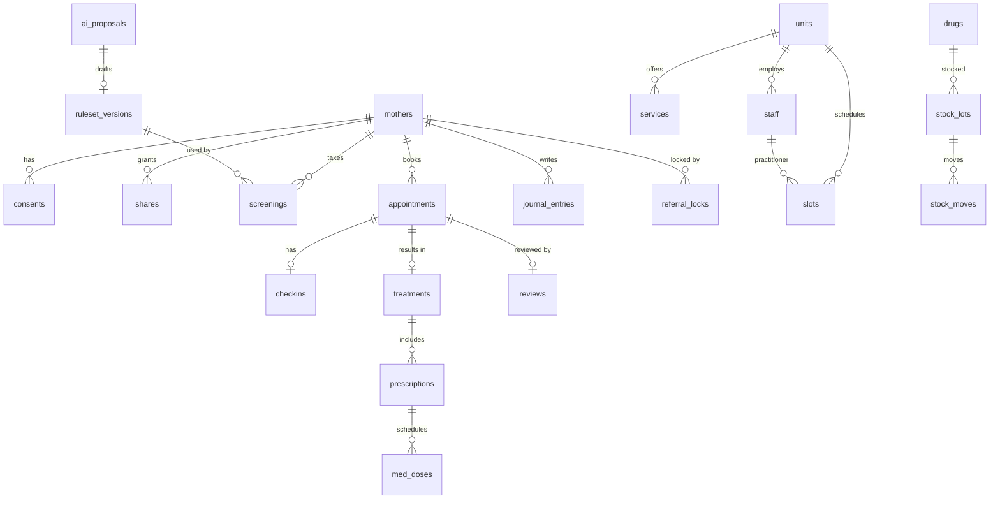
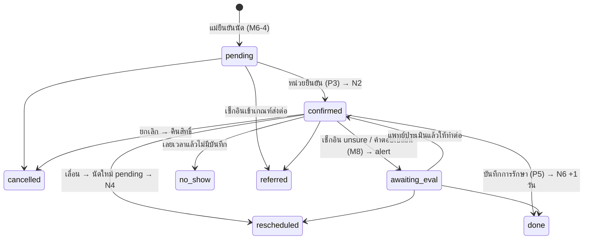

# Data model

> Postgres (Supabase) — ทุกตารางเปิด RLS ไม่มี policy (ADR-0004) · `id uuid pk default gen_random_uuid()` · `created_at timestamptz default now()` (ไม่เขียนซ้ำทุกตาราง)
> เวลาเก็บเป็น `timestamptz` ส่วนวันที่ (วันคลอด) เก็บเป็น `date` และคำนวณวันที่ตาม Asia/Bangkok

## 1. ER (ย่อ)

## 2. ตาราง

### ตัวตน + consent
| ตาราง | คอลัมน์ | หมายเหตุ |
|---|---|---|
| `mothers` | `line_user_id text unique`, `display_code text unique` ("B07"), `delivery_date date`, `delivery_method text` (enum ตาม rules §1), `chronic text[]`, `herbal_allergy answer`, `preeclampsia answer`, `regular_meds text`, `phone text`, `emergency_phone text` (ทั้งคู่บังคับใน M2 — ADR-0014), `coverage text null`, `preferred_unit_id uuid null`, `reminder_mode text default 'per_dose'`, `deleted_at` | `display_code` = ชื่อย่อที่ P3 แสดง |
| `consents` | `mother_id`, `tier text` (`care`\|`aggregate`), `granted_at`, `revoked_at null` | ดู consent ปัจจุบันจากแถวล่าสุดของแต่ละ tier |
| `shares` | `mother_id`, `unit_id`, `until timestamptz`, `revoked_at null` | ADR-0007 |
| `access_log` | `staff_id`, `mother_id`, `resource text` (`case_summary`\|`treatment`), `at` | append-only |

### หน่วยบริการ + ผู้ใช้เจ้าหน้าที่
| ตาราง | คอลัมน์ |
|---|---|
| `units` | `name`, `kind` (`ttm_center`\|`community_hospital`\|`sub_district`), `district`, `province`, `health_region int`, `lat`, `lng`, `phone`, `cancel_policy text` |
| `staff` | `user_id uuid null` (Supabase auth · null = แพทย์ที่เพิ่มในปฏิทินแต่ยังไม่มีบัญชี — Q18), `unit_id null` (null = กรมฯ), `role` (`doctor`\|`staff`\|`pharmacist`\|`dtam_viewer`\|`rule_approver`), `display_name`, `photo_url null`, `color text null` (hex สีการ์ดในปฏิทิน) — ADR-0014 |
| `services` | `unit_id`, `procedure`, `enabled bool`, `duration_min int`, `capacity_per_slot int`, `from_manual bool` (อบ = true) |
| `unit_start_days` | `unit_id`, `method_group` (`vaginal`\|`cesareanAny`), `start_day int` — **CHECK ≥ ค่าคู่มือ** (API validate กับ ruleset) |
| `slot_templates` | `unit_id`, `practitioner_id`, `weekday int`, `start_time time` — ตารางรายสัปดาห์ (P2) |
| `closures` | `unit_id`, `practitioner_id null`, `date`, `reason` — วันหยุด/วันลา |
| `slots` | `unit_id`, `practitioner_id`, `starts_at`, `capacity int`, `booked int` — สร้างจาก template ล่วงหน้า 30 วัน (materialize เพื่อ lock) |

### คัดกรอง
| ตาราง | คอลัมน์ |
|---|---|
| `ruleset_versions` | `version text unique`, `status` (`draft`\|`active`\|`rejected`), `body jsonb`, `change_summary`, `source_proposal_id null`, `approved_by null`, `approved_at null` — partial unique index: active ได้ทีละ 1 |
| `screenings` | `mother_id`, `kind` (`initial`\|`checkin`\|`recompute`), `appointment_id null`, `answers jsonb` (`[{qid, value, note?}]`), `result jsonb` (output ของ engine), `ruleset_version`, `day int` |
| `referral_locks` | `mother_id`, `screening_id`, `qid`, `contacted_at null` ("ฉันติดต่อแล้ว"), `unlocked_by null`, `unlocked_at null` |

### นัดหมาย
| ตาราง | คอลัมน์ |
|---|---|
| `appointments` | `mother_id null`, `guest_name text null`, `guest_phone text null` (นัดที่ staff สร้าง: `source='staff'`, CHECK `mother_id` หรือ `guest_name` อย่างใดอย่างหนึ่ง — Q12, ADR-0014), `source` (`mother`\|`staff`), `created_by_staff_id null`, `coverage text null`, `unit_id`, `slot_id`, `procedures text[]`, `kind` (`procedure`\|`eval`\|`course_day`), `course_id null`, `status` (§3), `quota_no int` ("ครั้งที่ 2 จาก 5"), `share_summary bool`, `rescheduled_from null` |
| `checkins` | `appointment_id unique`, `screening_id`, `pain int null (0–10)`, `outcome` (`unchanged`\|`awaiting_eval`\|`referred`) |
| `treatments` | `appointment_id unique`, `practitioner_id`, `eligibility_checked bool` (**CHECK = true**), `decisions jsonb` (`[{procedure, done, reason}]`), `pain_before`, `pain_after`, `icd10tm text`, `activity_codes text[]`, `next_appointment_id null` |
| `herbal_courses` | `mother_id`, `unit_id`, `created_by`, `start_date`, `days int`, `quota_warning bool` |

### ยา
| ตาราง | คอลัมน์ |
|---|---|
| `drugs` | `code`, `name`, `unit_label` (ซอง/ห่อ/ขวด), `group null` (`hom`), `reorder_point int`, `benefits text null`, `image_url null` (สร้าง/แก้โดย pharmacist — ADR-0014, Q17) |
| `stock_lots` | `unit_id`, `drug_id`, `lot`, `expiry date`, `qty int CHECK ≥ 0` |
| `stock_moves` | `lot_id`, `delta int`, `kind` (`receive`\|`dispense`\|`adjust`), `reason null` (adjust ต้องมี), `ref_prescription_id null`, `by` |
| `prescriptions` | `treatment_id`, `drug_id`, `dose`, `method`, `days`, `warnings jsonb`, `decision` (`none`\|`changed`\|`acknowledged`), `ruleset_version` |
| `med_doses` | `prescription_id`, `due_at`, `label` ("หลังอาหารเช้า"), `taken_at null`, `paused bool` |

### รีวิว + alert + journal
| ตาราง | คอลัมน์ |
|---|---|
| `reviews` | `appointment_id unique`, `pain_after int null`, `r_explain`, `r_clean`, `r_wait`, `r_overall` (1–5), `text null`, `adverse bool default false`, `adverse_text null`, `themes text[] null` (AI-2) |

`pain_after`/`adverse` optional เพราะฟอร์ม M10 ใน design ไม่มี (ต้นทาง = Q10) · แพทย์ของรีวิวอ่านจาก `appointments.slot_id → slots.practitioner_id` ไม่เก็บซ้ำ (ใช้กรองรายแพทย์ใน P8 — ADR-0014)
| `staff_alerts` | `unit_id`, `mother_id`, `kind` (`adverse_review`\|`adverse_med`\|`checkin_changed`\|`ai2_flag`), `ref_id`, `contacted_at null`, `contacted_by null`, `assignee_id null` (staff), `status` (`open`\|`following`\|`closed` default `open`), `note text null` — ADR-0014 |
| `journal_entries` | `mother_id`, `entry_date date`, `mood smallint` (1–5: เครียด · เหนื่อย · เรื่อย ๆ · สบายใจ · มีความสุข), `title text null`, `body text` — เห็นเฉพาะเจ้าของ ไม่เข้า shares/`agg_*`/AI จนกว่า Q11 ตัดสิน · ห้ามอยู่ในข้อความ LINE (ADR-0006) |

### AI + แจ้งเตือน
| ตาราง | คอลัมน์ |
|---|---|
| `ai_proposals` | `kind` (`ai1`), `scope jsonb` (filter), `finding`, `manual_says`, `manual_ref jsonb`, `causes jsonb` (≥2), `proposal`, `needs_data`, `confidence` (`low`\|`medium`\|`high`), `n_cases int`, `low_data bool`, `status` (`pending`\|`accepted`\|`rejected`\|`more_info`), `expert_comment`, `decided_by`, `model` |
| `notification_outbox` | `mother_id`, `template` (`N1`…`N8`), `scheduled_at`, `dedupe_key text unique`, `sent_at null`, `error null`, `attempts int` |

## 3. State machine — `appointments.status`

- **Quota used** = นับ `appointments` ของแม่ใน 3 เดือนที่ status ∈ {pending, confirmed, awaiting_eval, done} (`no_show` ⚠︎Q2) และ 1 แถว = 1 ครั้ง ไม่ว่าจะมีกี่หัตถการ (นัดที่ staff สร้างโดยไม่มี `mother_id` ไม่นับ — Q12)
- จองนัดใหม่ต้องทำใน transaction: `slots.booked < capacity` (row lock `FOR UPDATE`) + quota ยังไม่เต็ม + ไม่มีนัดวันเดียวกันอยู่แล้ว + ไม่มี `referral_locks` ที่ยังไม่ปลด
- เปลี่ยนสถานะทุกครั้ง: enqueue notification ที่เกี่ยวข้องใน transaction เดียวกัน (ADR-0010)

## 4. Stock
- ตัดสต็อกแบบ **FEFO** (lot ที่หมดอายุก่อนตัดก่อน) ตอนแพทย์ยืนยันใบสั่งยา
- สถานะคำนวณจากข้อมูล: `low` = Σqty < reorder_point · `expiring` = expiry − today < 60 วัน · `normal`
- ยาไม่พอ → API คืน `409 out_of_stock` → UI บอกทันที (P6)

## 5. Aggregate views (`0002_aggregates.sql`) — ADR-0008
ทุก view เป็น `security_invoker = false` เข้าถึงผ่าน API เท่านั้น:
- `agg_base` = mothers ที่มี consent `aggregate` ที่ยังไม่ถอน และยังไม่ถูกลบ (join region/province/unit/method)
- `agg_overview` (D1): registered, screened, booked, attended, referred, pain_avg_before/after — group by region, province, unit, month, method
- `agg_outcomes` (D2): pain before/after แยกตามหัตถการ, repeat rate, satisfaction, adverse count
- `agg_safety` (D3): referral count ตามเกณฑ์, **unsure rate แยกตามคำถาม**, median(contacted_at − referral), top exclusion, adverse
- `agg_access` (D4): distribution ของจำนวนสิทธิ์ที่ใช้ (1–5), procedures/unit, eval→procedure %, median queue days, no-show %, cesarean share
- `agg_drugs` (D5): dispensed ต่อยา, taken %, units low/expiring, warning decisions
- `agg_satisfaction` (D6): 4 ratings, themes %, monthly trend

**Suppression** ทำใน API (ไม่ทำใน SQL เพื่อให้ใช้กฎเดียวกันทุก view): นับ `n` ของแต่ละ cell ถ้า `n < 5` จะคืน `{ suppressed: true }` แทนค่า

## 6. Retention / delete
- `DELETE /me` → เปลี่ยน `mothers` เป็น tombstone (`deleted_at`, ล้าง PII + `line_user_id`) และลบ screenings/checkins/shares/med_doses/journal_entries/reviews.text ส่วน `treatments` + `prescriptions` เก็บไว้ตามนโยบายหน่วยบริการ (ADR-0007) โดยไม่มีลิงก์กลับไปหาตัวคน
- `access_log` เก็บ 1 ปี (⚠︎ ยืนยันกับนโยบาย)
